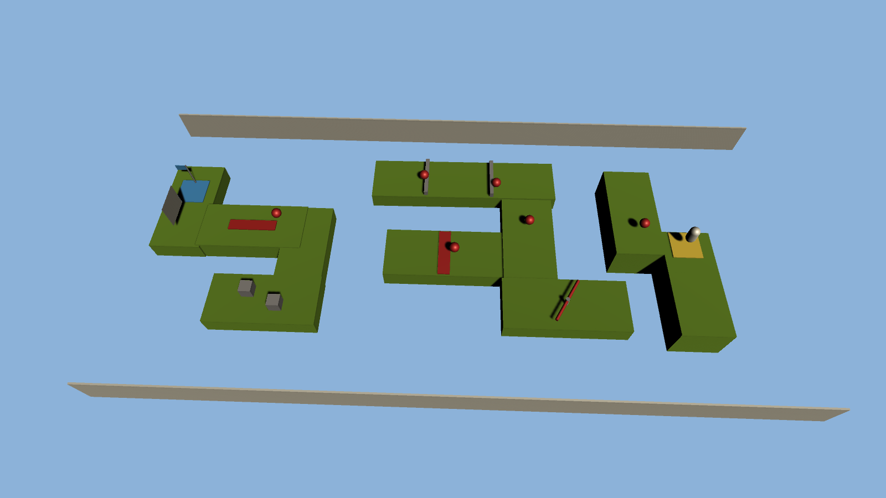
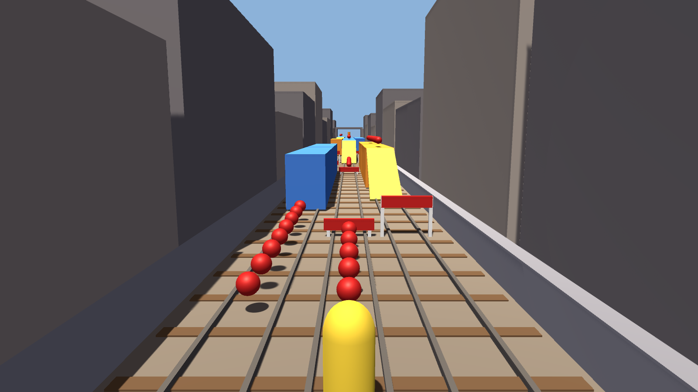

# CS464 Lab 03 · Mayasa Fakhar · BSCS23069

Two blockout levels made from cubes, cylinders, capsules, spheres and my floor and coin prefabs. The Unity project (2022.3) is in the `Lab 03` folder and the scenes are `Assets/Scenes/Level01.unity` and `Level02.unity`.

The lab document with the screenshots, the explanations and the references is `ITU-CS-464-LAB-03-BSCS23069.docx`.

## Level 01: Coin Hop (my own design)

A platform run in three sections at different heights, with gaps to jump, hurdles, a sweeping bar, red strips to jump over and blocks to weave round. It goes from the yellow start pad to the blue flag, collecting six coins on the way.

## Level 02: Subway Surfers track

A 170 m track with three lanes, 6 trains (3 with ramps onto the roof), 7 low barriers to jump, 5 high barriers to roll under, 88 coins, power-up spots, the inspector and his dog at the start and a tunnel at the end. The reference images are my own screenshots from the game in `Docs/reference`.

