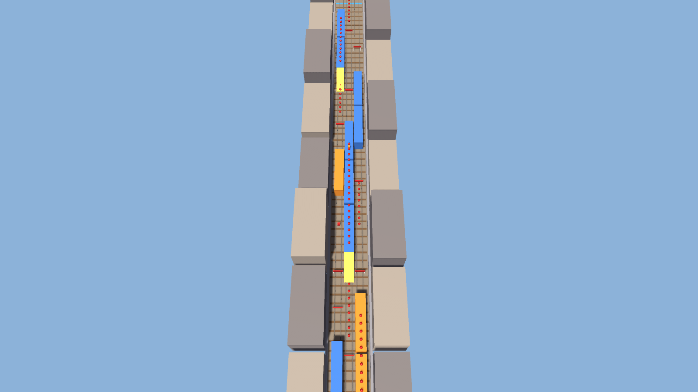

# CS464 Lab 03 · Mayasa Fakhar · BSCS23069

Two blockout levels made from cubes, cylinders, capsules, spheres and my floor and coin prefabs. The Unity project (2022.3) is in the `Lab 03` folder and the scenes are `Assets/Scenes/Level01.unity` and `Level02.unity`.

The lab document with the screenshots, the explanations and the reasons for the design is `ITU-CS-464-LAB-03-BSCS23069.docx`.

- **Level 01 video:** https://drive.google.com/file/d/1Swx6_1BnN9wQ9YkJCznqwFpCHkWjM2x8/view?usp=sharing
- **Level 02 video:** https://drive.google.com/file/d/1Tr2NxRlMBthaIeq-Ca-3ye1UhzVFbD9P/view?usp=sharing

## Level 01: Platform Run (my own design)

Three groups of green platforms at different heights (2 m, then up to 2.6 m, then down to 1 m) with gaps to jump between them and corners to turn. You go from the start on the right to the sign on the far left, about 52 m, collecting six coins.

## Level 02: Sky Steps (my own design)

A straight 64 m climb in the same style: four stepping pillars, a platform with two blocks to weave round, four stairs up to 3.5 m, a 1 m wide bridge with a red bar to jump, and the goal flag. Eight coins on the way.

